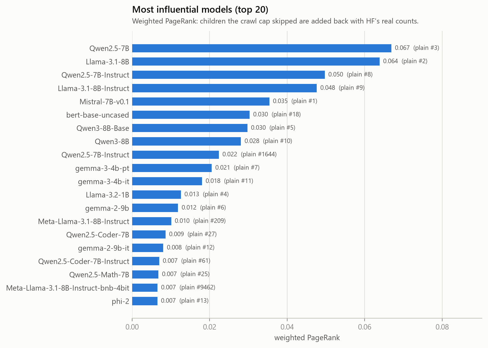
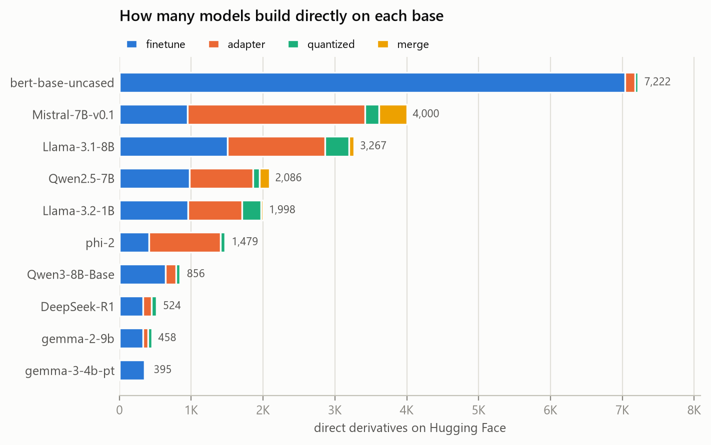
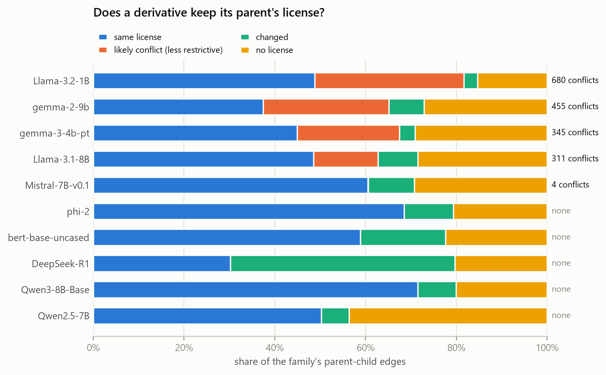
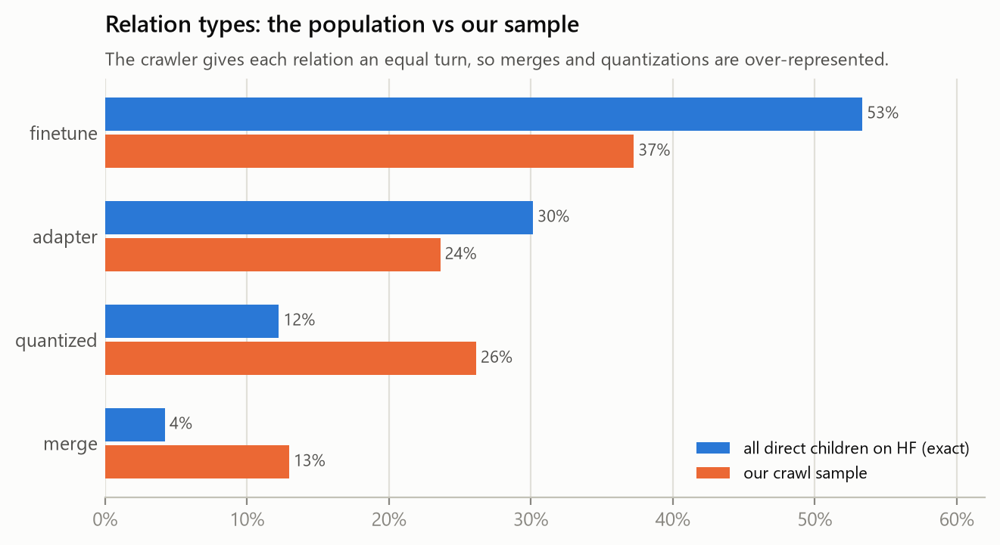
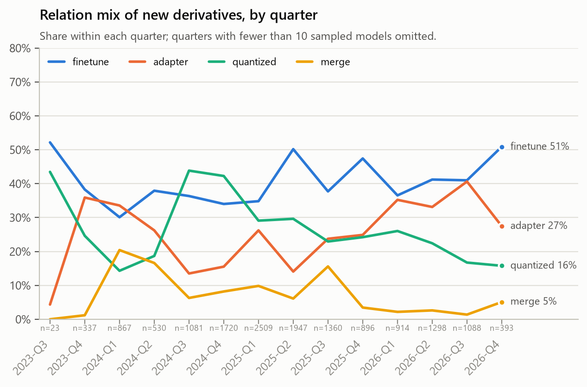
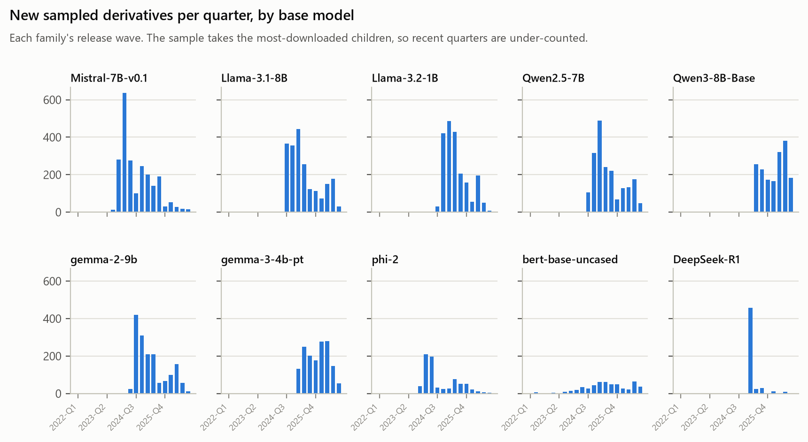
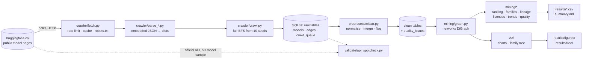
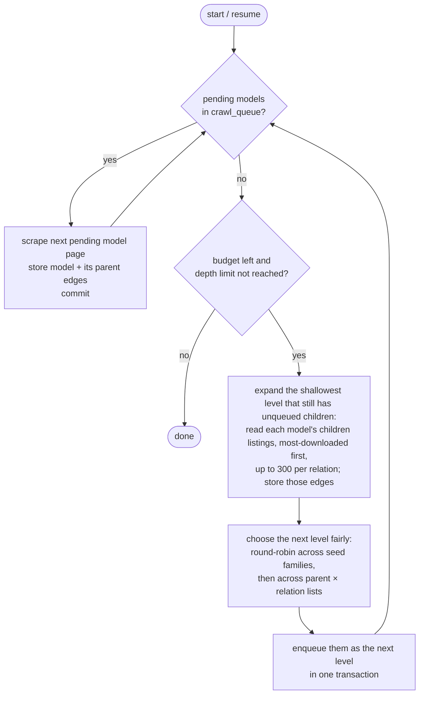

# Hugging Face Model Ecosystem Graph

Most open models on Hugging Face aren't trained from scratch. They're **fine-tunes, adapters,
quantizations or merges** of a few dozen base models, and those derivatives get derived from in
turn. This project maps that family tree. It crawls the public model pages, builds the
**lineage graph** (base model → derivatives), and mines it:

- **Influence:** which models does the ecosystem actually build on? (own PageRank / HITS, with a
  correction for sampling)
- **Families:** which groups of models belong together, and where do families mix? (Louvain)
- **Lineage shape:** how deep do derivation chains go, and how many children does a typical model
  have?
- **License drift:** do derivatives keep their parent's license? Where do they quietly drop
  restrictions?
- **Trends:** how does each family's release wave look, and are adapters or quantizations taking
  over from full fine-tunes?
- **Data quality:** how reliable is Hugging Face's own lineage metadata?

The results are browsable as an interactive family tree, and every number comes with the table
behind it.

<!-- RESULTS:START -->

## Results

> **Snapshot of a crawl in progress:** 15,026 of 20,000 models scraped (updated 2026-10-27 13:02 India Standard Time). This section is regenerated every 1,000 models.

### At a glance

| | |
|---|---|
| Models scraped | 15,014 |
| Models seen in total (incl. unscraped children and parents) | 22,499 |
| Lineage edges | 25,339 |
| Model families found (Louvain) | 71, matching the seed families with 100 % purity |
| Deepest derivation chain | 18 generations |
| Likely license conflicts | 1,795 of 15,927 parent-child pairs |
| Scraped models with no license | 3985 (26.5 %) |
| Broken parent links in model cards | 521 (2.8 %) |
| API spot-check | 99.6% match (50 random models x 11 fields; lowest field: downloads (within 10 %) 96%) |

### Most influential models

Weighted PageRank over all known lineage edges (see *Why a weighted PageRank*, below). *Plain rank* is the position before correcting for the crawl cap.

| # | Model | Weighted PageRank | Plain rank | Direct children on HF | Seed family |
|---|---|---|---|---|---|
| 1 | `Qwen/Qwen2.5-7B` | 0.0669 | 3 | 2,086 | Qwen2.5-7B |
| 2 | `meta-llama/Llama-3.1-8B` | 0.0638 | 2 | 3,267 | Llama-3.1-8B |
| 3 | `Qwen/Qwen2.5-7B-Instruct` | 0.0497 | 8 | 6,669 | Qwen2.5-7B |
| 4 | `meta-llama/Llama-3.1-8B-Instruct` | 0.0476 | 9 | 7,302 | Llama-3.1-8B |
| 5 | `mistralai/Mistral-7B-v0.1` | 0.0354 | 1 | 4,000 | Mistral-7B-v0.1 |
| 6 | `google-bert/bert-base-uncased` | 0.0303 | 18 | 7,222 | bert-base-uncased |
| 7 | `Qwen/Qwen3-8B-Base` | 0.0298 | 5 | 856 | Qwen3-8B-Base |
| 8 | `Qwen/Qwen3-8B` | 0.0281 | 10 | 5,133 | Qwen3-8B-Base |
| 9 | `unsloth/Qwen2.5-7B-Instruct` | 0.0224 | 1644 | 5,360 | Qwen2.5-7B |
| 10 | `google/gemma-3-4b-pt` | 0.0205 | 7 | 395 | gemma-3-4b-pt |

### Findings so far

- **What derivatives are made of.** Across the direct children Hugging Face lists for every scraped model: fine-tunes 53 %, adapters 30 %, quantizations 12 %, merges 4 %. The crawl sample is deliberately balanced, so it shows each at roughly 25 % instead.
- **Most derivatives are dead ends.** Of 6,484 first-generation derivatives, 88 % have no children of their own. The median is 0 children, but the mean is 5, pulled up by a few models that are major bases themselves (up to 7,302 children).
- **License drift.** 1,795 derivatives carry a *less* restrictive license than their parent. The most common case is a `gemma` model republished as `apache-2.0` (730 times). The highest conflict rates are Llama-3.2-1B 39 %, gemma-2-9b 38 %, gemma-3-4b-pt 32 %. Another 4,160 derivatives declare no license at all.
- **Families mostly stay apart.** Louvain finds 71 communities that match the seed families with 100 % purity. The exceptions are 6 lineage links between families, 100 % of them merges.
- **Latest quarter (2026-Q4, 393 sampled derivatives):** finetune 51 %, adapter 27 %, quantized 16 %, merge 5 %, mixed 1 %.

### Figures

| | |
|---|---|
|  |  |
|  |  |
|  |  |

All tables: [`results/summary.md`](results/summary.md) (CSV files in [`results/`](results/)). Interactive family tree: download the repo and open `results/tree/family_tree.html` (GitHub shows HTML files as source).

<!-- RESULTS:END -->

---

## The whole process at a glance



| Step | Command | What it does |
|---|---|---|
| 1. Crawl | `python -m crawler.crawl` | BFS over model pages from 10 base models into SQLite (≈ a day for 20 000 models) |
| 2. Clean | `python -m preprocess.clean` | Normalises fields, merges the two edge sources, records every data-quality problem |
| 3. Validate | `python -m validate.api_spotcheck` | Compares 50 random scraped records with Hugging Face's official API |
| 4. Mine | `python -m mining.report` | Runs all analyses → `results/*.csv` and `results/summary.md` |
| 5. Visualise | `python -m viz.charts` · `python -m viz.family_tree` | Static figures → `results/figures/`, interactive pages → `results/tree/` |
| 6. Explorer | `python -m viz.site_data` | Data for the Model Lineage Explorer → `site/data.js` |

Each step reads only what the previous one wrote, so any step can be re-run on its own.

---

## 1. How the crawler works

### What it reads

Hugging Face pages are server-rendered, and every interactive widget carries its data as JSON
in an HTML attribute:

```html
<div class="SVELTE_HYDRATER" data-target="ModelHeader" data-props="{&quot;model&quot;: {&quot;id&quot;: ...}}">
```

The crawler reads that JSON instead of scraping visible text, so a page redesign doesn't break
it. Only two page types are needed:

| Page | Example | What we take |
|---|---|---|
| **Model page** | `huggingface.co/Qwen/Qwen2.5-7B` | `ModelHeader` JSON: id, license, task, tags, downloads, likes, creation date, gated flag, the parsed model-card YAML; plus the *Model tree* box, which says how many children the model has per relation |
| **Children listing** | `huggingface.co/models?other=base_model:finetune:Qwen/Qwen2.5-7B&sort=downloads` | `ModelList` JSON: 30 child ids per page, total count, page index |

**Where the lineage edges come from.** For every parent a model declares, Hugging Face adds a
tag like `base_model:finetune:Qwen/Qwen2.5-7B` (relation ∈ finetune / adapter / quantized /
merge). So each model page tells us its own parents *and* the relation type. The listings show
the same edges from the parent's side and tell the crawler what to visit next. Both views are
stored, and they agree 100 % (see Data quality).

The raw `README.md` model card isn't fetched: the model page already embeds the same YAML
(verified identical on every sample), and skipping it halves the number of requests. Full field
map: [`docs/page_structure.md`](docs/page_structure.md).

### The crawl loop: breadth-first, one level at a time



1. **Seeds (depth 0).** Ten major base models from seven families: Llama-3.1-8B, Llama-3.2-1B,
   Mistral-7B-v0.1, Qwen2.5-7B, Qwen3-8B-Base, Gemma-2-9B, Gemma-3-4B, Phi-2, DeepSeek-R1,
   BERT-base-uncased (`config.SEEDS`).
2. **Scrape.** Each queued model's page is fetched and parsed. The model row and its
   *child → parent* edges (from its tags) are saved and committed on their own, so a crash loses
   at most one model.
3. **Expand.** For each scraped model, the crawler looks at the Model-tree counts. A relation
   with no children gets **no request at all**. That skips most models, because two thirds of
   derivatives have no children. Otherwise it reads the children listings, sorted by downloads,
   until it has 300 children for that relation or runs out.
4. **Select fairly.** A plain first-in-first-out queue would let the first seed swallow the whole
   budget (Llama-3.1-8B alone has 3 000+ children). So each level's budget is shared
   **round-robin**: first across seed families, then, within a family, across its
   (parent, relation) lists. Each list is already sorted by downloads, so every turn takes the
   most-used model left. A model reachable from two parents (a merge) is queued once.
5. **Repeat** to depth 3, or until 20 000 models are scraped.

**Limits** (all in `config.py`): `MAX_MODELS = 20 000`, `MAX_DEPTH = 3`,
`MAX_CHILDREN_PER_RELATION = 300`.

### Being a polite crawler

All network access goes through one class, `crawler/fetch.py`, so the rules hold everywhere:

| Rule | How |
|---|---|
| **robots.txt** | Re-read at the start of every run; any disallowed URL raises instead of being fetched. HF currently allows everything. |
| **Rate limit** | Hugging Face advertises `RateLimit-Policy: "fixed window";"pages";q=100;w=300` (100 page requests per 5 minutes), so the crawler sends **one request every 3 s**. It also reads the `RateLimit: r=<remaining>;t=<reset>` header on every response, and if the window is used up, it pauses until the reset instead of collecting a 429. |
| **Backoff** | 429 / 5xx / connection errors are retried after 2, 4, 8, 16, 32 s (or the server's `Retry-After`, if longer). |
| **Identification** | `User-Agent: hf-ecosystem-crawler/1.0 (+https://github.com/igris-ap/hf-ecosystem)` |
| **No re-fetching** | Every response is cached on disk (gzip, ~4× smaller). A URL that's been fetched is never requested again. |
| **Scope** | Public model metadata only. Per-model author profile data on listing pages (avatars, follower counts) is dropped, and gated or private files are never requested. The crawler sends no cookies or tokens. |

### Crash-safe and resumable

- **The cache is written in two steps:** the response body first, then a small metadata file.
  An entry only counts once its metadata exists, so a crash mid-write leaves nothing half-saved.
- **Database:** each model is committed on its own, and each new level is enqueued in a single
  transaction.
- **Resuming:** just run the same command again. Pages already on disk aren't re-downloaded.
  Models that failed on a network or server error are retried. Models that are genuinely
  missing or private (HTTP 401/404) stay skipped.
- **Growing the crawl:** a later run with a bigger `--max-models` continues the same BFS. It fills
  up the current level before going deeper.
- **Long runs:** while the crawler runs, it asks Windows not to idle-sleep. No power settings are
  changed, and the request ends with the process.

Tests simulate a crash before *every* request of a small crawl and check that the resumed run
produces the same database without downloading anything twice.

### What it costs

At 3 s per request, a 20 000-model crawl is about 29 000 requests (model pages + listing pages),
**roughly a day**, and about 1.7 GB of compressed cache. The cache and database live **outside
the repo** (`~/hf-ecosystem-data`, see `HF_ECOSYSTEM_DATA` below).

---

## 2. Cleaning (`preprocess/clean.py`)

The raw tables are never edited. Cleaning rebuilds `clean_models`, `clean_edges` and
`quality_issues` from scratch each run, so a rule can be changed and re-applied without
re-crawling.

- **Edges:** the child's tags and the parent's listing are merged into one row per
  (child, parent, relation), flagged with which source saw it. Self-loops are dropped.
  Contradicting relations are logged.
- **Declared parents:** card `base_model` values are normalised: URLs, `/tree/main` and stray
  whitespace are stripped, and local paths are dropped.
  - **Renamed repos are learned from the data.** If a card declares one base that Hugging Face
    didn't link, and HF linked one parent the card didn't declare, they are the same repo
    (e.g. `meta-llama/Meta-Llama-3.1-8B` → `meta-llama/Llama-3.1-8B`).
  - Anything else is a **broken parent link**.
- **Licenses:** grouped into *permissive · copyleft · restricted (Llama, Gemma, OpenRAIL…) ·
  non-commercial · other · unknown*.
- **Missing task:** inherited from the parent when all parents agree, and flagged as inherited.
- **Dates:** converted to UTC.
  - Repos older than March 2022 all show Hugging Face's placeholder creation date, so they are
    flagged and kept out of trends.
  - A model created **more than 7 days before its parent** is flagged as a temporal anomaly
    (re-used repos, lineage spam).

Every rule, and what it found: [`docs/cleaning.md`](docs/cleaning.md).

## 3. The graph (`mining/graph.py`)

A networkx `DiGraph` with edges pointing **child → parent** ("is derived from"). That's the
direction a citation points, so link-analysis rank flows towards the models everything is built
on. Two views:

- **Sample graph:** only scraped models, with full metadata.
- **All known edges:** also every unscraped child seen in a listing and every out-of-sample
  parent.

Lineage can't really loop. Cycles caused by bad metadata are detected (strongly connected
components) and broken by dropping the edge into the newest parent.

## 4. Mining (`mining/`)

| Analysis | Method | Output |
|---|---|---|
| **Influence** (`ranking.py`) | PageRank and HITS **implemented by hand** (power iteration; the maths is written out above each function) and checked against networkx to ~1e-10. See below for the cap correction. | `ranking_*.csv` |
| **Families** (`communities.py`) | Louvain modularity on the undirected graph (fixed seed), compared with the seed family each model came from; cross-family links are listed | `communities.csv`, `cross_family_links.csv` |
| **Lineage** (`lineage.py`) | Generation = longest derived-from chain to a root (one pass in topological order); branching factor per generation from HF's exact child counts | `lineage_*.csv` |
| **License drift** (`licenses.py`) | Parent vs child license on every edge. A child less restrictive than its parent (e.g. a Llama fine-tune relicensed Apache-2.0) is a **likely conflict** | `license_*.csv` |
| **Trends** (`trends.py`) | Derivatives by creation quarter, per family / task / relation | `trend_*.csv` |
| **Data quality** (`quality.py`) | Missing fields, broken links, source agreement, anomalies, API spot-check | `data_quality.csv` |

**Why a *weighted* PageRank.** The crawler reads at most 300 children per relation, so a base
with 7 000 fine-tunes looks no bigger than one with 300. Ordinary edge weights can't fix that,
since most models have one parent and that one edge carries all of its rank whatever the weight.
The cap removes *sources* of rank. So for every scraped parent, the missing
`HF count − sampled count` children are added back as one virtual node with that many times the
normal share of the random jump:

```
PR(v) = [ (1 − d) + d · D ] · m(v) / M  +  d · Σ_{u → v} PR(u) / out(u)
```

Here m(v) is how many models v stands for, M = Σ m, and D is the rank on parent-less nodes. This
is exact if the unscraped children are leaves. A test checks it: one virtual node for 8 leaves
gives exactly the ranks of 8 real leaves.

Method details and caveats: [`docs/mining.md`](docs/mining.md).

## Model Lineage Explorer (`site/`)

A search page for one model at a time. Open `site/index.html` in a browser; it needs an
internet connection for its fonts and graph library. Type any model name (or paste a Hugging
Face URL), and the page shows:

- **The model card:** family, relation to its parent, license and its category, task, downloads,
  likes, children on Hugging Face, and influence rank.
- **The lineage chain:** every path from an original base model down to this one, with the
  relation at each step. Click any model in a chain to jump to it.
- **The family graph:** ancestors, siblings and derivatives (size = influence, edge style =
  relation). For merges with dozens of parents it shows the 8 strongest.
- **Charts:** what's built on the model (by relation), and its downloads against its siblings'.
- **Drawbacks**, read from the metadata and ordered by severity:
  - a license less restrictive than the parent's (likely conflict);
  - no license, or a non-commercial or restricted one;
  - created before its claimed parent;
  - a broken parent link;
  - gated access;
  - quantization, adapter or many-parent-merge caveats;
  - an undeclared task;
  - far fewer downloads than its siblings.
- **Better alternatives:** models from the same lineage or base with the same task, ranked by
  adoption (downloads, likes) and license cleanliness. Each comes with its reasons, e.g.
  "648× more downloads · no license conflict · same task".

Drawbacks and alternatives are rule-based readings of public metadata, not quality
evaluations. Models only seen in a listing (not scraped yet) appear with whatever lineage is
known. `site/data.js` is regenerated by `python -m viz.site_data` and by the snapshot watcher.

## 5. Visualisation (`viz/`)

- **`results/figures/*.png`:** ranking, family sizes, population-vs-sample relation shares,
  license drift, relation mix over time, per-family release waves. Each figure has a CSV with
  the same numbers.
- **`results/tree/family_tree.html`:** the interactive family tree, plus one page per family.
  - **Encoding:** node size = weighted PageRank; colour + shape = family; edge dash = relation;
    hover shows details.
  - **Responsiveness:** only the top-N models are drawn, and physics stops once the layout
    settles.
  - **Offline:** the pages are self-contained and work without a network.
- **Colours were checked with a colour-vision validator.** Bar and line charts use ≤ 4 colours,
  which all pass. A network graph puts every colour next to every other, and 7 family colours
  fail that test even for normal vision. So the overview colours at most 3 families (choose
  with `--highlight`) and identifies the rest by shape, label and tooltip.

## 6. Validation (`validate/api_spotcheck.py`)

This is the only place the official Hugging Face API is used; collection is pure scraping. A
random sample of 50 scraped models is fetched from `/api/models/<id>` and compared field by
field: id, author, license, task, library, created date, gated, parent edges, tags, downloads,
likes. This checks that the parsers extract exactly what Hugging Face serves. It can't check
whether HF's metadata is itself right; the cleaning step is what catches that.

---

## Quick start

```bash
git clone https://github.com/igris-ap/hf-ecosystem.git
cd hf-ecosystem
python -m venv .venv
.venv/Scripts/python -m pip install -r requirements.txt      # Linux/macOS: .venv/bin/python
```

If pip fails with `CERTIFICATE_VERIFY_FAILED` (antivirus or proxy certificates), add
`--use-feature=truststore`.

**Just look:** open `site/index.html` (the Model Lineage Explorer) or
`results/tree/family_tree.html` in a browser, and browse `results/`.

**Re-run the analysis without crawling.** [`sample_data/`](sample_data/) holds a ready-cleaned
500-model crawl (3 MB):

```bash
HF_ECOSYSTEM_DATA=sample_data .venv/Scripts/python -m mining.report
HF_ECOSYSTEM_DATA=sample_data .venv/Scripts/python -m viz.charts
HF_ECOSYSTEM_DATA=sample_data .venv/Scripts/python -m viz.family_tree
```

In PowerShell, run `$env:HF_ECOSYSTEM_DATA = "sample_data"` first. The crawler refuses to write
into `sample_data/`.

**Crawl yourself:**

```bash
.venv/Scripts/python -m crawler.crawl --max-models 500     # quick test, ~35 min
.venv/Scripts/python -m crawler.crawl                      # full 20 000 models, ~1 day; re-run to resume
.venv/Scripts/python -m preprocess.clean
.venv/Scripts/python -m validate.api_spotcheck
.venv/Scripts/python -m mining.report
.venv/Scripts/python -m viz.charts
.venv/Scripts/python -m viz.family_tree                    # --family Llama · --highlight Qwen,Gemma · --top 200
```

Crawl data goes to `~/hf-ecosystem-data/` by default. Set `HF_ECOSYSTEM_DATA` to put it
elsewhere; a relative path counts from the repo root.

**Tests** (offline, ~15 s):

```bash
.venv/Scripts/python -m pytest
```

They cover the parsers (on saved real pages in `samples/`), the fetcher (fake network and
clock), the crawler (a fake Hugging Face, including crash-and-resume at every request), cleaning,
every mining algorithm against hand-worked examples and networkx, and the visualisations.

---

## Data and ethics

- **robots.txt** allows all paths (checked live at every run). Requests stay within Hugging Face's
  published rate limit.
- **Collected:** public model metadata only (ids, licenses, tags, counts, dates, declared bases).
  No user profiles, no gated or private content, nothing behind a login.
- **The official API** is used only for the validation sample, never for collection.
- **Downloads** are Hugging Face's rolling 30-day count, a snapshot of the crawl date.

More: [`docs/ethics.md`](docs/ethics.md).

## Limitations

- **The sample is biased by design.** The crawler takes the most-downloaded children first and
  gives every family and relation equal turns, so the long tail is under-represented and sample
  shares aren't population shares. Wherever possible, population claims use Hugging Face's exact
  per-model child counts instead.
- **Metadata errors propagate.** Lineage is only as good as what model authors declare. Wrong
  bases, missing licenses and unlinked official models (e.g. `Llama-3.2-1B-Instruct` declares no
  base) are measured, not fixed.
- **Some dates are placeholders.** Creation dates before March 2022 are HF placeholders, and
  recent quarters are under-counted in trends.

## Repository layout

```
config.py              seeds, limits, rate limit, paths
crawler/               fetch.py (network) · parse_model/listing/card.py · crawl.py (BFS → SQLite)
preprocess/clean.py    raw tables → clean tables + quality_issues
mining/                graph · ranking · communities · lineage · licenses · trends · quality · report
viz/                   charts.py · family_tree.py · palette.py
validate/              api_spotcheck.py
results/               generated tables, summary.md, figures/, tree/
site/                  Model Lineage Explorer (index.html + data.js)
sample_data/           500-model database for running without a crawl
samples/               saved real pages used by the parser tests
docs/                  page_structure · cleaning · mining · ethics
scripts/               fetch_samples.py · migrate_cache_gzip.py
tests/                 offline test suite
```
